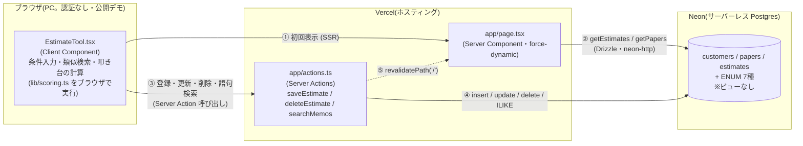

# システム構成図(つもる ― 見積アシスト PoC / as-built)

作成: 2026-10-12(WO-002) / 対象: `poc-next/`(ブランチ `master`・コミット `95ac31b` 時点)
関連: [SPEC.md](SPEC.md)(設計・判断の経緯) / [change-log.md](change-log.md) / [issue-log.md](issue-log.md) / [deploy-runbook.md](deploy-runbook.md)

> **読み方**: 本書は `src/` を読んで書いた「実際にそうなっているもの」。コードで確認できず推測した箇所は **【推測】**、動作は画面で確認したものだけ [test-scenarios.md](test-scenarios.md) に ✅ を付けている。
> **実装を変更したら、同じ変更でこの図も更新すること。**

## 1. 全体構成

- 認証・外部API・生成AI呼び出しは**無い**。「AI」に見える部分(類似度・叩き台)は**決定的な重み付き計算**で、LLMは使っていない(`lib/scoring.ts`)。
- ブラウザからDBへ直接は繋がない。接続文字列 `DATABASE_URL` はサーバ側(`src/db/index.ts`)だけが読む。

## 2. データフロー

| 流れ | 経路 | 備考 |
|---|---|---|
| 表示 | `page.tsx`(Server)が `getEstimates()`+`getPapers()` を `Promise.all` で取得 → `EstimateTool` に props で渡す | `export const dynamic = 'force-dynamic'`(毎リクエスト取得) |
| 類似検索・叩き台 | **ブラウザ内**で `rank()` → `detect()` → `buildDraft()`(`lib/scoring.ts`)。DBには問い合わせない | 母集団は表示時に渡された estimates 全件(status=reference/confirmed)。件数が増えると全件がブラウザに載る【推測: 38件では問題なし】 |
| 登録・更新 | フォーム → `onSaveSubmit` → `saveEstimate(null, FormData)`(Server Action) → `parseForm` で検証 → insert/update → `revalidatePath('/')` | hidden `id` の有無で分岐。成功後もダイアログは閉じない(B1) |
| 削除 | 一覧のインライン確認「はい」→ `deleteEstimate(id)` → `revalidatePath('/')` | 物理削除 |
| 語句検索 | `searchMemos(kw)` → `note`/`rework`/`reason` を ILIKE、先頭20件 | `/` 内の「詳しく見る」トグル |
| 確定金額の記録 | 「記録」→ `recordFinalAmount(input)`(Server Action) → 入力を1つずつ検証 → **叩き台をサーバーで再計算** → `estimates` に新しい行を insert(`status='draft'`・`source='tool'`・`cost=0`=原価未入力)→ `code` 付与 → `revalidatePath('/')` | 母集団(reference/confirmed)・一覧には入らない。再読み込み後は `getToolRecords()` の直近10件を記録欄に表示。誤記録は記録欄の「削除」(確認つき)で消せる → [ISSUE-P-005](issue-log.md)(対応済) |

## 3. Server Action・クエリ一覧

### Server Action(`src/app/actions.ts`・`'use server'`)

| 関数 | 入力 | 処理 | 書込み | 戻り値 |
|---|---|---|---|---|
| `saveEstimate(_prev, formData)` | フォーム値(`id` が空なら新規) | `parseForm` で検証 → `id` あり: `update … where id`(status/source は変えない) / なし: `insert`(`status='confirmed'`・`source='manual'`)→ `returning id` → `code='E-{id:3桁}'` を `update` | estimates | `{ok, message}` |
| `deleteEstimate(id)` | `id: number` | 正の整数を検査 → `delete where id returning id`(0件なら「対象が見つかりません」) | estimates | `{ok, message}` |
| `recordFinalAmount(input)` | `{type,size,paper,color,qty,finishing,dataState,reuse,amount,reason}`(`unknown` として受け、型・範囲・選択肢を1つずつ検証。`as` で済ませない) | 用紙を `papers` で確認 → `getEstimates()`+`rank`+`buildDraft` で叩き台を再計算(類似が無ければ記録しない)→ insert(`status='draft'`,`source='tool'`,`amount`=確定,`draft_amount`=叩き台,`reason`,`cost=0`,`name='【つもる記録】{種類} {サイズ} {色} {数量}部'`)→ `code='E-{id:3桁}'` を update | estimates | `{ok, message}` |
| `searchMemos(kw)` | 検索語 | 空なら `[]`。`%` `_` `\` をエスケープして `ilike(note) or ilike(rework) or ilike(reason)`、`limit 20` | なし | `{id, code, name, rework, note, reason, source, amount, draftAmount}[]`(記録行は `source='tool'` で判別し「【つもる記録】確定…(叩き台…)補正理由」と表示) |

`parseForm` の検証(DBに触れる前に return する): 案件名が空でない / `type`・`size`・`color`・`data_state`・`reuse` が `lib/scoring.ts` の選択肢定数に含まれる / `qty` は正の整数 / `amount`・`cost` は 0 以上 / `lead_days` は空または 0 以上 / `finishing` は選択肢外を除去。数値は `src/lib/input.ts` の `strictInt`(数字のみ・int4 上限以内。`12abc` や `1e3` は不正)で解釈する。DB エラーは画面に出さず固定文言を返し、詳細は `console.error`(サーバーログ)へ。

### 読み取りクエリ(`src/db/queries.ts`)

| 関数 | 内容 |
|---|---|
| `getEstimates()` | `estimates` を `papers` に **LEFT JOIN**(`family` を取得)。`status in ('reference','confirmed')`、`created_at desc`。列は明示列挙(`select *` なし) |
| `getPapers()` | `papers` を `name` 昇順で全件 |
| `getToolRecords(limit=10)` | `source='tool'` かつ `status='draft'` の行を新しい順に(記録欄の表示用。`id, code, draft_amount, amount, reason, created_at`) |

## 4. DB(Neon / Postgres)

マイグレーション: `drizzle/0000_*.sql` の1本のみ(`npm run db:migrate`)。スキーマの正は `src/db/schema.ts`。**ビューは無い**(ER設計上3テーブルだけ)。

| テーブル | 主キー | 主な列 | 備考 |
|---|---|---|---|
| `customers` | `id` serial | name, note, created_at | シードで「サンプル商店」1件のみ。UIからは未使用(S3の受け皿) |
| `papers` | `name` text | family | 用紙→系統の推移的従属をここに閉じる(3NF) |
| `estimates` | `id` serial | code, name, customer_id(FK, null可), status, source, type, size, paper(FK→papers.name), color, qty, finishing(text[]), data_state, reuse, amount, cost, draft_amount, reason, rework, note, lead_days, date, created_at, updated_at | 列の詳細は SPEC.md §3 |

ENUM(7種): `estimate_status`(reference/draft/confirmed/issued) / `estimate_source`(seed/manual/tool) / `product_type` / `size_type` / `color_type` / `data_state_type` / `reuse_type`。

**`source='tool'` の行の `cost=0` は「原価未入力」を表す。粗利計算には使わない**(`status='draft'` のため `getEstimates()` の母集団に入らず、`marginOf` に渡らない)。将来 `draft`→`confirmed` の昇格を作る場合は、原価の入力を必須にすること(`cost=0` のまま `confirmed` にすると粗利100%として母集団を汚す)。

**現状使われていない列・値**(受け皿として存在): `estimates.customer_id`・`date`(シードのみ)、status の `issued`。`draft_amount`・`reason`・status `draft`・source `tool` は確定金額の記録(WO-003)で使用。→ [ISSUE-P-005](issue-log.md)

## 5. ソース構成と型の置き場

| パス | 役割 |
|---|---|
| `src/app/page.tsx` | `/` の Server Component。データ取得して `EstimateTool` へ |
| `src/app/layout.tsx` / `globals.css` | 共通レイアウト(`lang="ja"`、Geist フォント)・スタイル |
| `src/app/actions.ts` | Server Actions(§3) |
| `src/lib/input.ts` | 入力の厳密な解釈(`strictInt`・`INT4_MAX`・`escapeLike`)。`'use server'` ファイルには非同期関数しか置けないため分離 |
| `scripts/db-snapshot.ts` | DB の控え取り(`dump`)と突き合わせ(`diff`)。**読み取り専用**。書込み試験の前後で使う |
| `src/components/EstimateTool.tsx` | 唯一のUI。条件入力・結果・登録/編集ダイアログ・一覧ダイアログ・検索・確定記録(`'use client'`) |
| `src/lib/scoring.ts` | フレームワーク非依存の計算: `score` / `rank` / `detect`(対象外5型) / `buildDraft` / `savings` と選択肢定数(`TYPES`…`REUSES`) |
| `src/db/schema.ts` | Drizzle スキーマ・ENUM・型 `Estimate` / `NewEstimate` |
| `src/db/index.ts` | `drizzle(neon(DATABASE_URL))`。未設定なら起動時に throw。接続文字列の前後の空白・引用符は除去(P-003 再発防止) |
| `src/db/queries.ts` | 読み取りクエリ(§3) |
| `src/db/seed.ts` / `seed-data.json` | 合成(仮)36件の投入。実行前に全表を delete する冪等方式 |

**型の置き場(重複あり)**:
- DB行の型 = `src/db/schema.ts` の `Estimate`/`NewEstimate`(`$inferSelect`/`$inferInsert`)。
- 画面で使う行の型 = `src/lib/scoring.ts` の `EstimateRow`(JOIN 後の形・`family` を持つ)。`getEstimates()` の戻りは `as EstimateRow[]` でキャストしている。
- ENUM の選択肢が **`schema.ts`(pgEnum)と `scoring.ts`(定数配列)の2か所**にある。`scoring.ts` 側は「ENUMと一致」とコメントされているが、機械的な同期はされていない → [ISSUE-P-010](issue-log.md)
- `saveEstimate` は `as NewEstimate['type']` 等のキャストで値を渡している(直前に許可リスト検証済み)。

## 6. 環境と実行場所

| 項目 | 内容 |
|---|---|
| フレームワーク | Next.js 16.3.0(App Router・Turbopack)/ React 19.2 |
| DB接続 | `@neondatabase/serverless`(HTTP)+ `drizzle-orm/neon-http` |
| 環境変数 | `DATABASE_URL` のみ(ローカル `.env.local` / Vercel の環境変数)。値は本書に書かない |
| ビルド/起動 | `npm run dev` / `build` / `start`、DB: `db:generate` `db:migrate` `db:push` `db:seed` |
| 本番 | Vercel。詳細は [deploy-runbook.md](deploy-runbook.md) |
| **ローカルと本番のDB** | **同じ Neon DB を共有している**(ローカルで書込み操作をすると本番データが変わる) |

## 7. 既知の制約(設計どおり)

- 認証なしの公開デモ。誰でも登録・編集・削除できる(SPEC §1)。
- 意味検索(pgvector)は未実装(Phase 2)。語句検索は ILIKE のみ。
- 見積書発行・メール連携・MIS連携は対象外(S3本体。SPEC §8)。
