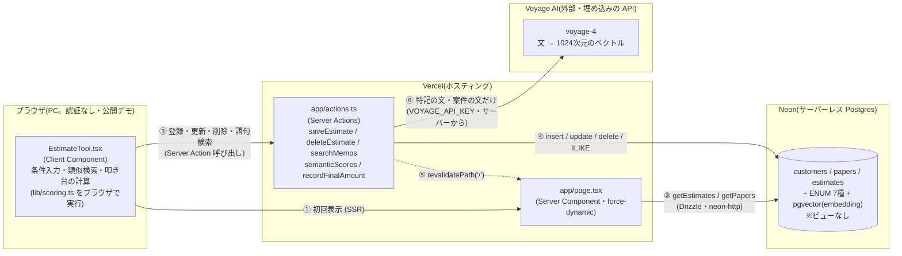

# システム構成図(つもる ― 見積アシスト PoC / as-built)

作成: 2026-10-12(WO-002) / 最終更新: 2026-10-20(WO-023 意味検索) / 対象: `poc-next/`(ブランチ `master`)
関連: [SPEC.md](SPEC.md)(設計・判断の経緯) / [change-log.md](change-log.md) / [issue-log.md](issue-log.md) / [deploy-runbook.md](deploy-runbook.md)

> **読み方**: 本書は `src/` を読んで書いた「実際にそうなっているもの」。コードで確認できず推測した箇所は **【推測】**、動作は画面で確認したものだけ [test-scenarios.md](test-scenarios.md) に ✅ を付けている。
> **実装を変更したら、同じ変更でこの図も更新すること。**

## 1. 全体構成

- 認証は**無い**。外部 API は **Voyage AI の埋め込み**だけ(2026-10 WO-023)。サーバー(Server Action・`scripts/embed-backfill.ts`)からだけ呼び、キー `VOYAGE_API_KEY` はブラウザに出さない(`NEXT_PUBLIC_` を付けない。ビルドの `.next/static` にキーの名前も呼び先も含まれないことを確認)。
- 送るのは「特記・要望」の自由文と、過去案件の文(案件名・仕様・メモ・手戻り事由)だけ。**金額・原価・叩き台・補正理由・納期・日付・顧客は送らない**(SPEC §5-2)。Voyage AI は「学習に使わせない」設定にする(代表が設定)。
- 生成 AI(文を作る AI)は使っていない。叩き台の金額は**決定的な重み付き計算**(`lib/scoring.ts`)。AI の埋め込みは、根拠の4件の**選び方**に「文の意味の近さ」を足すのにだけ使う。
- ブラウザからDBへ直接は繋がない。接続文字列 `DATABASE_URL` はサーバ側(`src/db/index.ts`)だけが読む。

## 2. データフロー

| 流れ | 経路 | 備考 |
|---|---|---|
| 表示 | `page.tsx`(Server)が `getEstimates()`+`getPapers()` を `Promise.all` で取得 → `EstimateTool` に props で渡す | `export const dynamic = 'force-dynamic'`(毎リクエスト取得) |
| 類似検索・叩き台 | **ブラウザ内**で `rank()` → `detect()` → `buildDraft()`(`lib/scoring.ts`)。特記が空ならDBには問い合わせない。特記があるときだけ先に `semanticScores(text)`(Server Action)で文の意味の近さ(案件の id → 類似度)を受け取り、`rank(q, rows, sims)` に渡す | 母集団は表示時に渡された estimates 全件(status=reference/confirmed)。件数が増えると全件がブラウザに載る【推測: 38件では問題なし】 |
| 登録・更新 | フォーム → `onSaveSubmit` → `saveEstimate(null, FormData)`(Server Action) → `parseForm` で検証 → insert/update → `revalidatePath('/')` | hidden `id` の有無で分岐。成功後もダイアログは閉じない(B1) |
| 削除 | 一覧のインライン確認「はい」→ `deleteEstimate(id)` → `revalidatePath('/')` | 物理削除 |
| 意味検索 | `semanticScores(text)` → 文字列・200文字までを検証 → キーが無ければ使えない旨を返す → Voyage で自由文を埋め込む(`input_type: query`)→ `getSimilarities(vec)`(pgvector の `<=>`)→ `{id: 類似度}` だけを返す(埋め込みの数はブラウザに渡さない) | 失敗しても例外にせず `{ok:false, reason, message}`。画面は条件の点だけで出し、1行で知らせる |
| 語句検索 | `searchMemos(kw)` → `note`/`rework`/`reason` を ILIKE、先頭20件 | `/` の常時表示の帯(WO-009 で折りたたみを廃止) |
| 確定金額の記録 | 「記録」→ `recordFinalAmount(input)`(Server Action) → 入力を1つずつ検証 → **叩き台をサーバーで再計算**(特記があれば同じ手順で意味の近さも測る。WO-023)→ `estimates` に新しい行を insert(`status='draft'`・`source='tool'`・`cost=0`=原価未入力)→ `code` 付与 → `revalidatePath('/')` | 母集団(reference/confirmed)・一覧には入らない。再読み込み後は `getToolRecords()` の直近10件を記録欄に表示。誤記録は記録欄の「削除」(確認つき)で消せる → [ISSUE-P-005](issue-log.md)(対応済) |

## 3. Server Action・クエリ一覧

### Server Action(`src/app/actions.ts`・`'use server'`)

| 関数 | 入力 | 処理 | 書込み | 戻り値 |
|---|---|---|---|---|
| `saveEstimate(_prev, formData)` | フォーム値(`id` が空なら新規) | `parseForm` で検証 → `id` あり: `update … where id`(status/source は変えない) / なし: `insert`(`status='confirmed'`・`source='manual'`)→ `returning id` → `code='E-{id:3桁}'` を `update` → **埋め込みを作り直す**(`embedding` を NULL に戻し、キーがあれば Voyage で作って書く。失敗しても登録は成功のまま=「意味検索の準備はあとで行います」) | estimates | `{ok, message}` |
| `semanticScores(text)` | 特記・要望の自由文(`unknown` として受ける) | 上の「意味検索」 | なし | `{ok:true, sims}` / `{ok:false, reason: invalid/nokey/notready/failed, message}` |
| `deleteEstimate(id)` | `id: number` | 正の整数を検査 → `delete where id returning id`(0件なら「対象が見つかりません」) | estimates | `{ok, message}` |
| `recordFinalAmount(input)` | `{type,size,paper,color,qty,finishing,dataState,reuse,amount,reason,request,shownDraft}`(`unknown` として受け、型・範囲・選択肢を1つずつ検証。`as` で済ませない。`request`=特記・200文字まで) | 用紙を `papers` で確認 → 特記があれば意味の近さを測る → `getEstimates()`+`rank`+`buildDraft` で叩き台を再計算(類似が無ければ記録しない)→ insert(`status='draft'`,`source='tool'`,`amount`=確定,`draft_amount`=叩き台,`reason`,`note`=特記,`cost=0`,`name='【つもる記録】{種類} {サイズ} {色} {数量}部'`)→ `code='E-{id:3桁}'` を update | estimates | `{ok, message}` |
| `searchMemos(kw)` | 検索語 | 空なら `[]`。`%` `_` `\` をエスケープして `ilike(note) or ilike(rework) or ilike(reason)`、`limit 20` | なし | `{id, code, name, rework, note, reason, source, amount, draftAmount}[]`(記録行は `source='tool'` で判別し「【つもる記録】確定…(叩き台…)補正理由」と表示) |

`parseForm` の検証(DBに触れる前に return する): 案件名が空でない・100文字まで / `type`・`size`・`color`・`data_state`・`reuse` が DB の ENUM の値(`schema.ts` の `enumValues`)に含まれる(型の絞り込み関数 `oneOf` で判定し、`as` のキャストは使わない) / `qty` は1〜1,000,000(`parseQty`) / `amount`・`cost` は1円以上 / `lead_days` は空または 0 以上 / メモ・手戻り事由は200文字まで / `finishing` は選択肢外を除去(2026-10-14・WO-016)。上限は `src/lib/input.ts` に集め、画面とサーバーで同じ値を使う。数値は `src/lib/input.ts` の `strictInt`(数字のみ・int4 上限以内。`12abc` や `1e3` は不正)で解釈する。DB エラーは画面に出さず固定文言を返し、詳細は `console.error`(サーバーログ)へ。

### 読み取りクエリ(`src/db/queries.ts`)

| 関数 | 内容 |
|---|---|
| `getEstimates()` | `estimates` を `papers` に **LEFT JOIN**(`family` を取得)。`status in ('reference','confirmed')`、`created_at desc`。列は明示列挙(`select *` なし) |
| `getPapers()` | `papers` を `name` 昇順で全件 |
| `getToolRecords(limit=10)` | `source='tool'` かつ `status='draft'` の行を新しい順に(記録欄の表示用。`id, code, draft_amount, amount, reason, created_at`) |
| `getSimilarities(vec)` | 母集団(reference/confirmed)で `embedding` のある行の `1 - (embedding <=> vec)`(コサイン類似度)。`id` と近さだけ。索引なしの全件比較 |

## 4. DB(Neon / Postgres)

マイグレーション: `drizzle/0000_*.sql` と `drizzle/0001_semantic_search.sql`(WO-023: `CREATE EXTENSION vector`+`embedding vector(1024)`・`embedding_model text` を NULL 許容で追加。予行演習と戻しの SQL は `drizzle/rollback/`)(`npm run db:migrate`)。**0001 を本番に適用してから、WO-023 のコードを push する**(Drizzle の insert は全列を書くので、列が無い DB では登録・記録が失敗する)。スキーマの正は `src/db/schema.ts`。**ビューは無い**(ER設計上3テーブルだけ)。

| テーブル | 主キー | 主な列 | 備考 |
|---|---|---|---|
| `customers` | `id` serial | name, note, created_at | シードで「サンプル商店」1件のみ。UIからは未使用(S3の受け皿) |
| `papers` | `name` text | family | 用紙→系統の推移的従属をここに閉じる(3NF) |
| `estimates` | `id` serial | code, name, customer_id(FK, null可), status, source, type, size, paper(FK→papers.name), color, qty, finishing(text[]), data_state, reuse, amount, cost, draft_amount, reason, rework, note, lead_days, date, created_at, updated_at, embedding(vector(1024)), embedding_model | 列の詳細は SPEC.md §3 |

ENUM(7種): `estimate_status`(reference/draft/confirmed/issued) / `estimate_source`(seed/manual/tool) / `product_type` / `size_type` / `color_type` / `data_state_type` / `reuse_type`。

**`source='tool'` の行の `cost=0` は「原価未入力」を表す。粗利計算には使わない**(`status='draft'` のため `getEstimates()` の母集団に入らず、`marginOf` に渡らない)。将来 `draft`→`confirmed` の昇格を作る場合は、原価の入力を必須にすること(`cost=0` のまま `confirmed` にすると粗利100%として母集団を汚す)。

**現状使われていない列・値**(受け皿として存在): `estimates.customer_id`・`date`(シードのみ)、status の `issued`。`draft_amount`・`reason`・status `draft`・source `tool` は確定金額の記録(WO-003)で使用。→ [ISSUE-P-005](issue-log.md)

## 5. ソース構成と型の置き場

| パス | 役割 |
|---|---|
| `src/app/page.tsx` | `/` の Server Component。データ取得して `EstimateTool` へ |
| `src/app/layout.tsx` / `globals.css` | 共通レイアウト(`lang="ja"`)・スタイル。色・文字・余白は `globals.css` の `:root` の変数の1か所(DESIGN-SYSTEM.md)。書体は Zen Kaku Gothic New を `next/font/google` でビルド時に取り込む(WO-022。ビルドにネット接続が要る) |
| `src/app/error.tsx` / `not-found.tsx` | 想定外のエラー・存在しないページの日本語の画面 |
| `src/app/actions.ts` | Server Actions(§3) |
| `src/lib/embedding.ts` | Voyage AI の呼び出し(`embedTexts`・時間切れ8秒・応答を1つずつ検証)と、過去案件を1つの文にする `caseText`(外に送る中身)。サーバーと scripts からだけ使う |
| `scripts/embed-backfill.ts` | 母集団の埋め込みの無い行に埋め込みを付ける。既定は予行(外に送らない・書かない)、`--write` で書く |
| `src/lib/input.ts` | 入力の厳密な解釈(`strictInt`・`INT4_MAX`・`escapeLike`・特記の上限 `REQUEST_MAX`)。`'use server'` ファイルには非同期関数しか置けないため分離 |
| `scripts/db-snapshot.ts` | DB の控え取り(`dump`)と突き合わせ(`diff`。`--ignore-embedding` で埋め込みの2列を外して比べる)。**読み取り専用**。書込み試験の前後で使う |
| `src/components/EstimateTool.tsx` | 画面の本体(`'use client'`)。状態・叩き台の計算の呼び出し(`rank`/`detect`/`buildDraft`)・Server Action の呼び出しをここに集める |
| `src/components/estimate/*` | 画面の部品(WO-022 で分けた): `AppBar`(紺の帯)・`ConditionPanel`(条件)・`StaleNotice`(条件が変わった帯)・`DraftPanel`(叩き台)・`JudgeBand`(判定の帯)・`BasisList`(根拠。特記があれば条件の近さ・文の意味)・`SemanticNotice`(意味検索が使えないときの1行)・`RecordPanel`(確定金額の記録)・`MemoSearch`・`MobileActionBar`(スマホの下のバー)・`ListDialog`・`EstimateFormDialog`、共通の `ui.tsx`・表示の整形 `format.ts`・幅の判定 `useMediaQuery.ts`・型 `types.ts`。計算はしない |
| `src/lib/scoring.ts` | フレームワーク非依存の計算: `score` / `rank` / `detect`(ネット印刷で自動で完結しない条件の5型。②は型抜きのみ・折りも選ばれたときは `note` で事前見積を示す) / `buildDraft`(画面の説明用に `baseQty`・`scaleClamped` も返す) と選択肢定数。`savings` は 2026-10-14 に削除(削減効果の欄の撤去)(`TYPES`…`REUSES`) |
| `src/db/schema.ts` | Drizzle スキーマ・ENUM・型 `Estimate` / `NewEstimate` |
| `src/db/index.ts` | `drizzle(neon(DATABASE_URL))`。未設定なら起動時に throw。接続文字列の前後の空白・引用符は除去(P-003 再発防止) |
| `src/db/queries.ts` | 読み取りクエリ(§3) |
| `src/db/seed.ts` / `seed-data.json` | 合成(仮)36件の投入。実行前に全表を delete する冪等方式 |

**型の置き場(重複あり)**:
- DB行の型 = `src/db/schema.ts` の `Estimate`/`NewEstimate`(`$inferSelect`/`$inferInsert`)。
- 画面で使う行の型 = `src/lib/scoring.ts` の `EstimateRow`(JOIN 後の形・`family` を持つ)。`getEstimates()` の戻りは `as EstimateRow[]` でキャストしている。
- ENUM の選択肢が **`schema.ts`(pgEnum)と `scoring.ts`(定数配列)の2か所**にある。`scoring.ts` 側は「ENUMと一致」とコメントされているが、機械的な同期はされていない → [ISSUE-P-010](issue-log.md)
- ~~`saveEstimate` は `as NewEstimate['type']` 等のキャストで値を渡している~~ → 2026-10-14(WO-016)に ENUM の値で絞り込む関数に置き換えた。`recordFinalAmount` も `typeof` で絞り込む形にした。

## 6. 環境と実行場所

| 項目 | 内容 |
|---|---|
| フレームワーク | Next.js 16.3.0(App Router・Turbopack)/ React 19.2 |
| DB接続 | `@neondatabase/serverless`(HTTP)+ `drizzle-orm/neon-http` |
| 環境変数 | `DATABASE_URL` と `VOYAGE_API_KEY`(WO-023。無くても動く=意味検索なし)。ローカル `.env.local` / Vercel の環境変数。値は本書に書かない |
| ビルド/起動 | `npm run dev` / `build` / `start`、DB: `db:generate` `db:migrate` `db:push` `db:seed` |
| 本番 | Vercel。詳細は [deploy-runbook.md](deploy-runbook.md) |
| **ローカルと本番のDB** | **同じ Neon DB を共有している**(ローカルで書込み操作をすると本番データが変わる) |

## 7. 既知の制約(設計どおり)

- 認証なしの公開デモ。誰でも登録・編集・削除できる(SPEC §1)。
- 意味検索(WO-023)は「特記・要望」に文を入れたときの根拠の選び方だけ。文で別の種類の案件を根拠にはしない(strong の判定は条件の点のまま)。メモの語句検索は ILIKE のまま。
- 公開デモから誰でも特記を送れる=外部 API(Voyage AI)を呼べる。文の長さはサーバーで200文字までに制限。
- 見積書発行・メール連携・MIS連携は対象外(S3本体。SPEC §8)。
